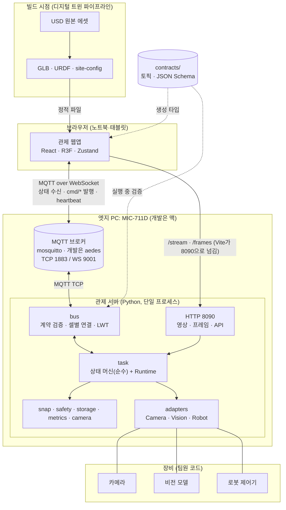
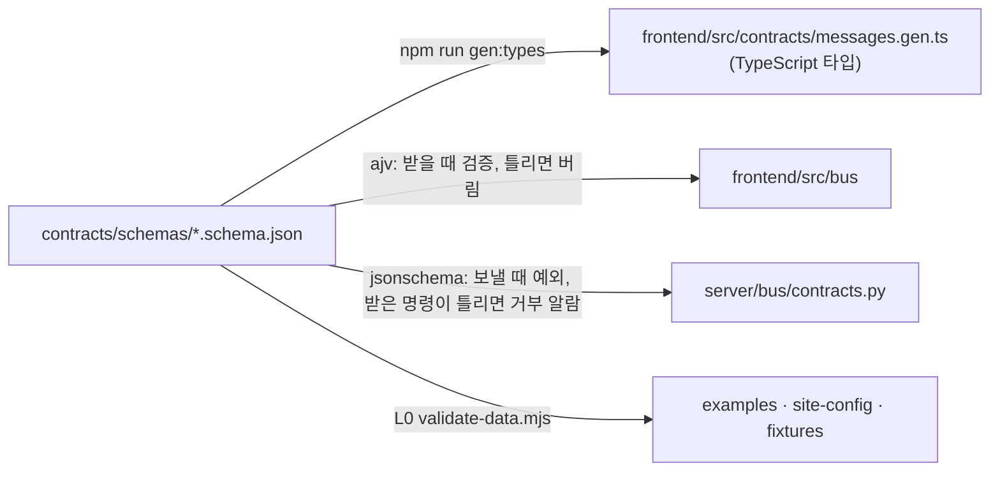
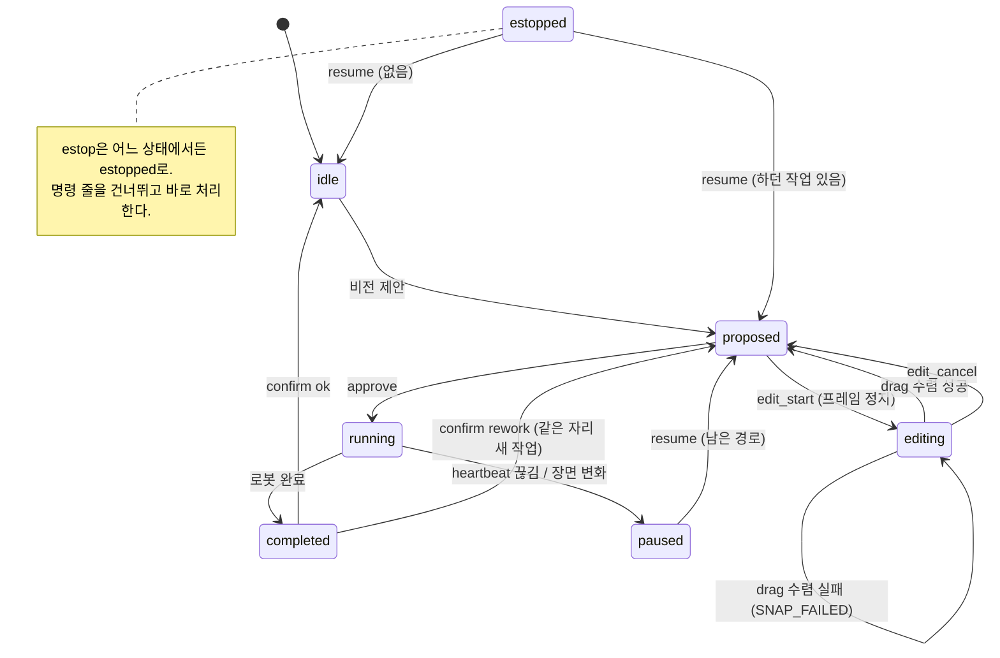
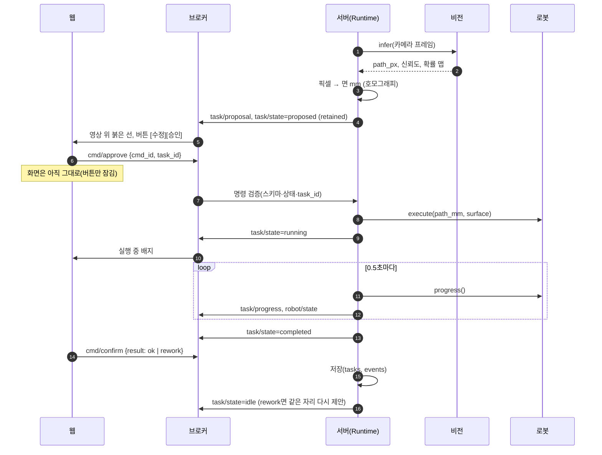
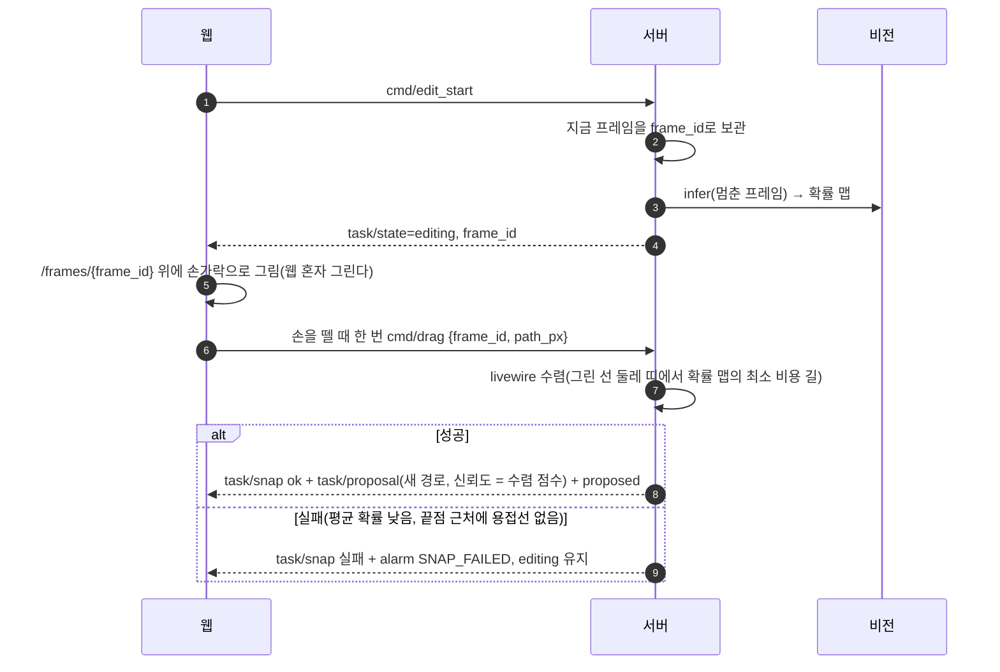
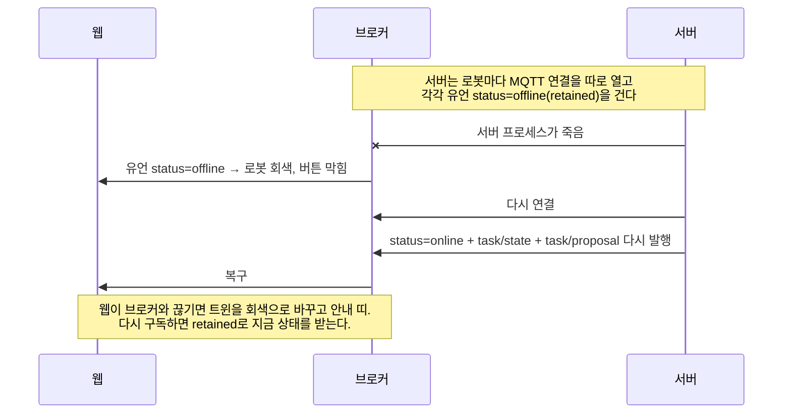
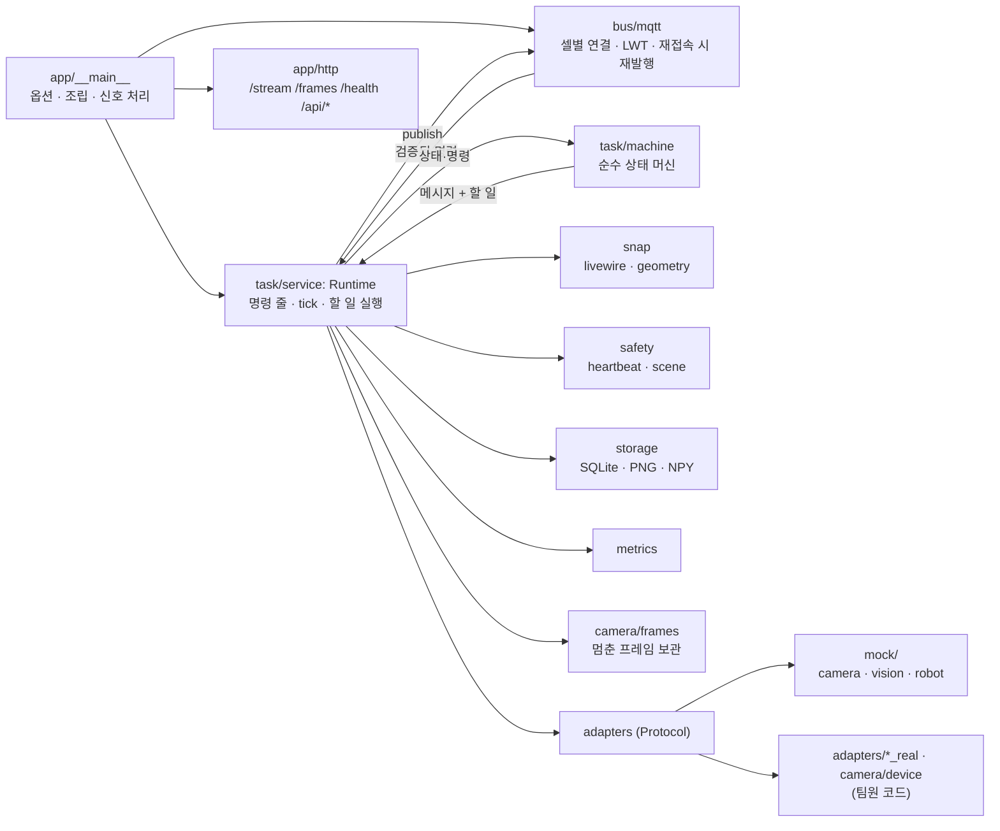
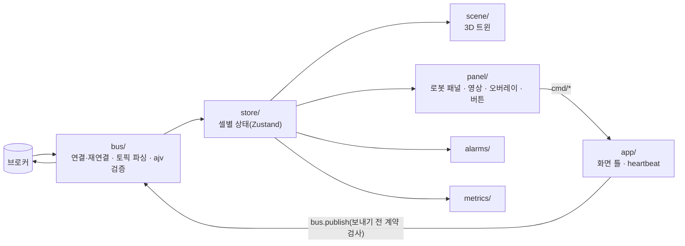
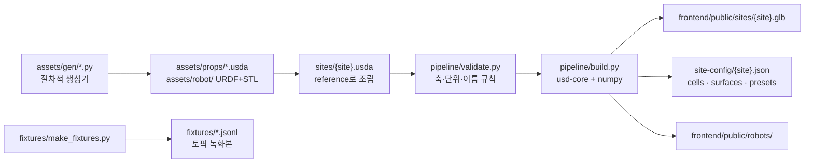
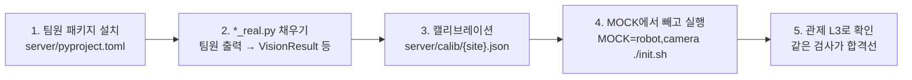

# 아키텍처 위키

> 시스템이 어떻게 짜여 있고 왜 그렇게 정했는지를 한곳에 모았다. 각 절 끝의 **코드**·**상세** 링크로 근거를 따라갈 수 있다.
> 무엇을 만드는지는 [overview.md](overview.md), 실행은 [usage.md](usage.md).

목차

1. [전체 그림](#1-전체-그림)
2. [설계 원칙](#2-설계-원칙)
3. [저장소 구조](#3-저장소-구조)
4. [공통 규약(contracts)](#4-공통-규약contracts)
5. [작업 상태 머신](#5-작업-상태-머신)
6. [주요 흐름](#6-주요-흐름)
7. [구획별 내부 구조](#7-구획별-내부-구조): [서버](#71-서버-server) · [프론트](#72-프론트-frontend) · [디지털 트윈](#73-디지털-트윈-digital-twin)
8. [검증 하네스](#8-검증-하네스)
9. [확장 지점](#9-확장-지점)
10. [배포와 포트](#10-배포와-포트)
11. [설계 결정 기록(ADR)](#11-설계-결정-기록adr)
12. [알려진 한계와 열린 문제](#12-알려진-한계와-열린-문제)

---

## 1. 전체 그림



- 웹과 서버는 **브로커를 거쳐서만** 말한다(영상만 HTTP). 서로의 주소를 몰라도 되고, 화면을 여러 개 띄워도 같은 상태를 본다.
- **서버가 작업 상태의 유일한 기준**이다. 웹은 명령을 보내고, 서버가 보낸 상태를 받아 화면을 그린다.
- **계약(`contracts/`)** 이 웹·서버·녹화본·검사의 공통 기준이다. 프론트는 스키마에서 타입을 생성하고, 서버는 실행 중에 스키마로 검증한다.
- 3D 장면의 정적 부분(건물·블록)은 **빌드 때** USD에서 GLB로 만든다. 실시간으로 움직이는 것(로봇 관절·용접선·알람)만 메시지를 받는다.

## 2. 설계 원칙

| 원칙 | 이유 | 어디서 지키나 |
| --- | --- | --- |
| 작업 상태의 기준은 서버다. 웹은 명령만 보내고, 화면은 서버 상태를 받은 뒤에 바꾼다 | 화면이 여러 개이거나 명령이 거부돼도 화면과 실제가 어긋나지 않는다. 용접은 되돌릴 수 없다 | `frontend/src/panel/controls.ts`(버튼은 서버 상태로만), L3 "보낸 직후 화면이 안 바뀐다" |
| 메시지 형식은 `contracts/schemas`에서만 고친다 | 웹·서버·녹화본이 한 기준을 따른다. 손으로 쓴 타입이 서로 어긋나는 일을 없앤다 | `npm run gen:types`, L0 "생성 타입 최신", 서버 `bus/contracts.py` |
| 팀원 코드(비전·로봇)는 `server/adapters/` 안에서만 import한다 | 팀원 쪽 시그니처가 바뀌어도 고칠 곳이 한 군데다 | `adapters/base.py` 인터페이스, `*_real.py` |
| 새 기능은 Mock으로 끝까지 동작시킨 뒤 실제 구현을 붙인다 | 장비 없이 맥에서 개발·검사한다. 같은 검사가 실제 구현의 합격선이 된다 | Mock 어댑터, Node Mock 서버, 녹화본 |
| 단위: 길이 mm(면 좌표), 3D 위치 m(사이트 좌표), 각도 deg, 시간 epoch ms, 영상 좌표는 원본 프레임 픽셀 | 변환 실수를 막는다. 화면 크기와 무관하게 경로를 보관한다 | [contracts/docs/README.md](../contracts/docs/README.md) |
| 사이트·로봇 이름으로 분기하지 않는다 | 사이트를 더할 때 코드를 고치지 않는다(M4에서 확인: 공장 추가 시 프론트 0줄) | lint 규칙, site-config |
| 설계를 바꾸면 ADR 한 장 | 나중에 "왜"를 묻는 사람이 코드에서 추측하지 않게 | [docs/adr/](adr/) |

## 3. 저장소 구조

```
platform/
├─ init.sh          한 번에 실행(준비 + 브로커·서버·프론트)
├─ contracts/       공통 규약: topics.json, schemas/*.schema.json, examples/(valid·invalid), gen-types.mjs
├─ digital-twin/    3D 원본과 검사 장치
│  ├─ assets/       재사용 에셋: gen/(절차적 생성기), props/(USD), robot/(URDF+STL), materials/
│  ├─ sites/        사이트 조립 USD(ship-block, factory)
│  ├─ pipeline/     USD 검증·GLB 빌드(Python, uv)
│  ├─ site-config/  웹이 읽는 사이트 설정(JSON)
│  ├─ fixtures/     시나리오 녹화본(JSONL)과 생성기
│  └─ harness/      check.sh, shot.sh, Playwright 검사(e2e/), 기준 이미지(golden/)
├─ server/          관제 서버(Python): app, bus, task, camera, snap, safety, storage, metrics, adapters, mock
├─ frontend/        관제 웹앱(React): app, bus, store, scene, panel, alarms, metrics, lab
├─ infra/           dev.sh(실행), broker.mjs(개발 브로커), mosquitto.conf(엣지 브로커)
├─ tools/           Node Mock 서버, 녹화본 재생기, 검사용 서버 실행기
├─ tests/server/    서버 단위 검사(pytest)
├─ data/            작업 기록(git 제외)
└─ docs/            overview · usage · architecture(이 문서), adr/
```

구획마다 `docs/README.md`가 입구다. 구획을 넘는 변경은 `contracts/`부터 고친다.

## 4. 공통 규약(contracts)

### 토픽

접두사 `innoworks`. `{cell}`은 **로봇 1대**(ADR 0003).

| 토픽 | 방향 | QoS | retained | 내용 |
| --- | --- | --- | --- | --- |
| `{site}/{cell}/status` | 서버→웹 | 1 | ✓ (LWT) | `online` / `offline` |
| `{site}/{cell}/task/state` | 서버→웹 | 1 | ✓ | 작업 상태 7개, `task_id` |
| `{site}/{cell}/task/proposal` | 서버→웹 | 1 | ✓ | 제안 경로: 면 mm `path` + 영상 `path_px`, `frame_id`, `frame_size`, `surface`, 신뢰도 |
| `{site}/{cell}/task/snap` | 서버→웹 | 1 | | 수렴 결과(성공·실패, 경로) |
| `{site}/{cell}/task/progress` | 서버→웹 | 0 | | 진행률 0~1 |
| `{site}/{cell}/robot/state` | 서버→웹 | 0 | | 관절각 + 이동 로봇은 몸통 자세(`base`)·발 자석(`contacts`), 10~20Hz |
| `{site}/{cell}/vision/metrics` | 서버→웹 | 0 | | 추론 지연, 신뢰도, 외란 강도 |
| `{site}/{cell}/alarm` | 서버→웹 | 1 | | `alarm_id`, 심각도, 코드, `active`, 거부된 `cmd_id` |
| `{site}/{cell}/cmd/{이름}` | 웹→서버 | 1 | | `edit_start`, `edit_cancel`, `drag`, `approve`, `confirm`, `estop`, `resume` |
| `{site}/cmd/{estop\|resume}` | 웹→서버 | 1 | | 사이트 전체 정지·재개 |
| `operator/{client_id}/heartbeat` | 웹→서버 | 0 | | 1초마다 |

규칙: "지금 값"이 중요한 것(상태·제안·연결)은 retained, 명령·이벤트는 retained 금지. 명령은 요청일 뿐이고 결과는 항상 `task/state`나 `alarm`으로 돌아온다. 모든 명령에는 웹이 만든 `cmd_id`가 있어 거부 알람과 짝을 맞춘다.

### 스키마가 흐르는 길



### 좌표

| 좌표계 | 단위 | 쓰는 곳 |
| --- | --- | --- |
| 사이트 | m, Z-up(USD와 같다) | site-config, `robot/state.base` |
| 면(surface) | mm, 면 위 XY, +Z는 로봇이 붙는 쪽 | 이동 로봇 경로(`task/proposal.path`) |
| 작업판 | mm | 고정 로봇 경로(`factory`) |
| 영상 | 원본 프레임 픽셀, 좌상단 원점 | `path_px`, `cmd/drag` |
| three.js 씬 | m, Y-up | 프론트 내부(사이트 그룹 안은 사이트 좌표 그대로) |

픽셀 → 면 mm 변환(호모그래피)은 **서버**가 한다. 로봇 어댑터는 mm 경로를 받는다.

**상세**: [contracts/docs/README.md](../contracts/docs/README.md) · **코드**: `contracts/topics.json`, `contracts/schemas/`

## 5. 작업 상태 머신



- 허용되지 않는 상태의 명령, 지난 `task_id`·`frame_id`의 명령, 계약을 어긴 명령은 **거부**(`CMD_REJECTED`, 상태 그대로).
- 명령은 받은 순서대로 하나씩 처리한다(수정 시작 → 드래그처럼 앞 결과가 필요). 긴급정지만 줄을 서지 않는다.
- 용접 중에 멈췄다가 재개하면 **남은 경로**만 다시 제안하고, 진행률은 처음 경로 기준으로 이어진다.
- 상태 머신은 **순수 함수**다. 입력(상태, 명령) → 출력(새 상태, 보낼 메시지, 할 일 목록). 실제 일(로봇 실행, 프레임 정지, 수렴, 저장)은 Runtime이 한다. 그래서 MQTT·장비 없이 모든 전이를 단위 검사한다.

알람 id는 로봇마다 고정(`{cell}-estop`, `{cell}-heartbeat`, `{cell}-snap`, `{cell}-scene`)이라, 재개·수정 종료 때 같은 id로 `active=false`를 보내 해제한다.

**상세**: [server/docs/state-machine.md](../server/docs/state-machine.md) · **코드**: `server/task/machine.py`, `tools/mock/machine.mjs`(Node Mock, 같은 표) · **검사**: `tests/server/test_machine.py`, `tools/mock/machine.test.mjs`

## 6. 주요 흐름

### 6.1 제안 → 승인 → 용접 → 확인



### 6.2 수정: 그리기 → 수렴



수렴 알고리즘: 그린 선에서 40px 띠 안의 확률 맵을 격자로 읽고, 두 끝점 근처의 확률 최댓값을 시작·끝으로 잡아 Dijkstra(비용 `1 - 확률`)로 잇는다. 1280×720에서 0.1초 안팎. 확률 맵을 내지 않는 모델이면 제안 경로에 붙이는 단순 수렴으로 물러선다. **상세**: [server/docs/snap.md](../server/docs/snap.md)

### 6.3 안전 정지

| 조건 | 감지 | 결과 |
| --- | --- | --- |
| 긴급정지 버튼 | `cmd/estop`(로봇 한 대) 또는 `{site}/cmd/estop`(전체) | 어느 상태든 `estopped`, 로봇 `stop()`, 치명 알람. 명령 줄을 건너뛴다 |
| 운영자 화면 끊김 | heartbeat가 3초 넘게 없음(한 번도 안 왔으면 판정 안 함) | 용접 중 로봇 `paused` |
| 카메라 장면 변화 | 이웃 프레임 밝기 차이가 3장 연달아 기준 초과 | 용접 중 로봇 `paused`(실제 카메라에서만) |
| 서버 비정상 종료 | 브로커가 로봇마다 유언 `status=offline` | 웹이 버튼을 막는다. 로봇 쪽 정지는 로봇 제어기 통신 감시(팀원 확인 필요) |

소프트웨어 정지는 하드웨어 E-stop을 대신하지 않는다. 재개는 사람이 `resume`으로만 한다. **상세**: [server/docs/safety.md](../server/docs/safety.md)

### 6.4 연결이 끊겼다 붙을 때



로봇마다 연결을 따로 여는 이유: MQTT 연결 하나에 유언은 하나뿐이라, 계약의 로봇별 `status`를 유언으로 지키려면 연결이 로봇 수만큼 필요하다(ADR 0004 열린 문제 → ADR 0007에서 결정).

구독 직후에는 브로커가 예전 retained 메시지를 새 실시간 메시지보다 늦게 줄 수 있다. 웹 store는 이미 받은 것보다 `ts`가 오래된 `task/state`·`task/proposal`을 버린다(`frontend/src/store/twin-store.ts`).

## 7. 구획별 내부 구조

### 7.1 서버 (`server/`)

Python 3.12+ · FastAPI + uvicorn · paho-mqtt · jsonschema · numpy. 단일 프로세스 asyncio.



- **의존 방향**: `app → task → (camera, snap, safety, storage, adapters)`. 밖으로 나가는 말은 모두 `bus`를 거친다. `task`는 MQTT를 모른다.
- **상태 머신과 Runtime 분리**: `machine.py`는 `Result(accepted, 보낼 메시지, 할 일)`만 돌려준다. 할 일 종류: `execute`, `stop`, `reset`, `freeze`, `snap`, `propose`, `record`. `service.py`가 그 할 일을 실행한다.
- **주기 작업**(100ms tick): 대기 로봇에 제안, 용접 중 진행률(0.5초), heartbeat·장면 변화 감시, `robot/state` 발행. 메트릭은 1초마다.
- **시작·종료**: 준비되면 표준 출력에 `READY http=<포트>`. SIGTERM/SIGINT면 로봇마다 `offline`을 보내고 내려간다.

어댑터 인터페이스(`server/adapters/base.py`):

| 인터페이스 | 메서드 | 뜻 |
| --- | --- | --- |
| `Camera` | `cells()`, `latest(cell) → Frame`, `calibration(cell) → {surface, H}`, `close()` | 로봇별 최신 프레임과 픽셀→면 mm 호모그래피 |
| `VisionAdapter` | `infer(frame) → VisionResult(path_px, confidence, prob, latency_ms)`, `metrics(cell, now_ms)` | 용접선 제안. `prob`(확률 맵)이 있으면 livewire 수렴을 쓴다 |
| `RobotAdapter` | `execute(cell, path_mm, surface)`, `stop(cell)`, `reset(cell)`, `progress(cell) → (0~1, 끝?)`, `get_state(cell)`, `close()` | 용접 실행(바로 돌아오고 진행은 `progress`로), 정지, 자세 |

**상세**: [server/docs/README.md](../server/docs/README.md) · [mock.md](../server/docs/mock.md) · [storage.md](../server/docs/storage.md)

### 7.2 프론트 (`frontend/`)

React + Vite + TypeScript · R3F(three.js) + drei · Zustand · mqtt.js.



| 계층 | 하는 일 |
| --- | --- |
| `app/` | 화면 틀(상태 줄·패널·손잡이·트윈·하단 독), bus 연결, heartbeat 1초, `window.__app`(검사용) |
| `bus/` | `innoworks/{site}/#` 구독, payload를 계약으로 검사(틀리면 경고하고 버림), 명령 발행 |
| `store/` | 셀별 `task`, 제안·수렴, 진행률, 관절 샘플, 알람, 메트릭, 연결 상태 |
| `scene/` | 배경 GLB, 로봇(URDF), 면 위 용접선, 상태 램프·라벨·알람 마커, 카메라 프리셋, 선택. site-config와 store만 읽는다 |
| `panel/` | 로봇 목록·패널, 카메라 뷰 + canvas 경로, 수정 모드(Pointer Events), 상태별 버튼 표(`controls.ts`) |
| `lab/` | 개발용 화면: 트윈 랩(녹화본 재생, `window.__twin`), 로봇 랩 |

- 화면 컴포넌트는 MQTT를 직접 만지지 않는다. 의존 방향: `scene/panel/alarms/metrics → store → bus`.
- 관절각처럼 자주 오는 데이터는 React 리렌더 없이 `useFrame`에서 store를 직접 읽고 보간한다.
- 경로는 **원본 프레임 픽셀**로 보관하고 그릴 때만 화면 크기로 변환한다(화면 크기가 바뀌어도 1px 안, L3 UI-03).
- 수정 중 선은 웹 혼자 그리고 손을 뗄 때 `cmd/drag` 한 번.
- 3D 트윈의 상태 색(램프·용접선)과 2D 패널 색은 다르다. 2D는 흑백 + 멈춤만 빨강(ADR 0006).

**상세**: [frontend/docs/README.md](../frontend/docs/README.md) · [spec.md](../frontend/docs/spec.md) · 화면 양식 `frontend/DESIGN.md`

### 7.3 디지털 트윈 (`digital-twin/`)



- **두 층**: 정적 층(건물·블록·크레인)은 빌드 때만 바뀌고 데이터가 붙지 않는다. 동적 층(로봇 관절·용접선·알람·상태 색)은 메시지마다 바뀐다.
- **이름 하나로 연결**: USD prim `/ShipBlock/Spider1/Robot` = 토픽 `innoworks/ship-block/spider-1/…` = site-config `cells[id="spider-1"]`. 웹은 토픽의 `{site}/{cell}`만 보고 3D 객체를 찾는다.
- **GLB를 Python으로**(ADR 0002): Blender 없이 결정적으로 빌드해 L1에서 결과물이 최신인지 바이트로 확인한다.
- **녹화본**: 토픽 메시지를 시간 순서로 적은 JSONL. 트윈 랩 재생, 브로커 재생(`tools/play.mjs`), Mock 로봇 자세 원본으로 함께 쓴다.

| 사이트 | 내용 | 로봇 |
| --- | --- | --- |
| `ship-block` | 건조 도크 안 이중저 블록(외판·론지·늑판·거더·측면 외판), 면 2개(`bottom-shell`, `side-shell`), 주변 도크·선체·크레인·작업 장비 | 4족 자석발 이동 용접 로봇 `spider-welder` 2대 |
| `factory` | 제조공장 용접 부스 1개 | 고정형 6축 대역 |

**상세**: [digital-twin/docs/README.md](../digital-twin/docs/README.md) · [spec.md](../digital-twin/docs/spec.md) · [harness.md](../digital-twin/docs/harness.md)

## 8. 검증 하네스

`digital-twin/harness/check.sh` 하나로 돈다. 서버·브로커·로봇 없이 돈다(검사가 빈 포트에 브로커와 서버를 스스로 띄운다).

| 단계 | 무엇 | 도구 |
| --- | --- | --- |
| L0 정적 | 타입, lint, 생성 타입·녹화본이 최신인지, 예시·site-config·녹화본이 계약을 지키는지 | tsc, eslint, ajv |
| L1 에셋 | USD 규칙, GLB 예산, 빌드 결과가 USD와 같은지 | usd-core |
| L2 단위 | 좌표·보간·버튼 표, Node Mock 상태 머신, 서버 상태 머신·수렴·저장 | Vitest, node --test, pytest |
| L3 시나리오 | 트윈 장면 상태, 관제 흐름 UI-01~10. 관제 흐름은 **Node Mock과 파이썬 서버 둘 다**로 돈다 | Playwright + `window.__twin`·`__app` |
| L4 스크린샷 | 승인된 기준 이미지와 비교(픽셀 0.5% 허용) | Playwright |
| L5 성능 | fps, 드로우 콜, 삼각형, 로딩 시간 예산(`budget.json`) | Playwright |
| H 사람 | 태블릿 터치, 3D 품질 | 사람 |

- 검사는 화면 픽셀이 아니라 **상태 값**(`window.__twin`, `window.__app`)으로 단언한다. 픽셀은 L4만 본다.
- 같은 L3를 두 서버가 통과한다는 것이 "서버가 Mock과 같은 규칙을 지킨다"는 근거다(`tools/server-under-test.mjs`가 `WELD_SERVER=python`이면 파이썬 서버를 자식 프로세스로 띄운다).
- 기준 이미지는 사람이 승인해야 바뀐다(`--candidates` → 승인 → `--update-golden`).

**상세**: [digital-twin/docs/harness.md](../digital-twin/docs/harness.md)

## 9. 확장 지점

### 실제 장비 붙이기



| 붙일 것 | 파일 | 할 일 |
| --- | --- | --- |
| 비전 모델 | `server/adapters/vision_real.py` | 모델 로드, `infer`에서 출력을 `VisionResult`로(`path_px`는 원본 픽셀, `prob`가 있으면 수렴 정확도가 오른다) |
| 로봇 제어 | `server/adapters/robot_real.py` | `execute`(면 mm 경로)·`stop`·`progress`·`get_state`(관절·몸통 자세)를 팀원 API에 연결 |
| 카메라 | `server/camera/device.py` | OpenCV 장치, `server/calib/{site}.json`에 로봇별 장치·호모그래피 |

각 파일 머리말에 연결 순서를 적어 두었다. 팀원 패키지 이름(`weld_vision`, `weld_robot`)과 시그니처는 아직 확인 전이다.

### 사이트 추가 · 계약 변경

- 사이트: 에셋 생성기 → `sites/{site}.usda` → `build.py` → 녹화본 → 검사 장면 → 기준 이미지 승인. 프론트 코드는 고치지 않는다. [digital-twin/docs/README.md](../digital-twin/docs/README.md) "사이트 추가하기"
- 계약: 예시(valid·invalid) → 스키마(선택 필드로 더하면 `v`는 그대로) → `npm run gen:types` → L0. [contracts/docs/README.md](../contracts/docs/README.md) "스키마를 바꿀 때"

## 10. 배포와 포트

| | 개발(맥) | 엣지(MIC-711D, 예정) |
| --- | --- | --- |
| 브로커 | aedes(`infra/broker.mjs`, Node) | mosquitto(`infra/mosquitto.conf`, retained 영속) |
| 서버 | `server/.venv`, Mock 장비 | 같은 코드, 실제 어댑터 |
| 웹 | Vite 개발 서버 5173(`/stream`·`/frames`를 8090으로 넘김) | `frontend/dist`를 서버가 `/`로 정적 서빙 |
| 실행 | `./init.sh` | (Jetson 실행 확인 후 정한다) |

| 포트 | 누가 | 쓰는 쪽 |
| --- | --- | --- |
| 1883 | 브로커 TCP | 서버, 도구 |
| 9001 | 브로커 WebSocket | 브라우저 |
| 8090 | 서버 HTTP | 영상, 프레임, API |
| 5173 | Vite 개발 서버 | 브라우저(개발) |

## 11. 설계 결정 기록(ADR)

| ADR | 결정 | 한 줄 이유 |
| --- | --- | --- |
| [0001](adr/0001-디지털-트윈-우선-개발.md) | 디지털 트윈을 먼저, 녹화본으로 개발 | 가리킬 대상(사이트·로봇)과 이름 규칙이 먼저 있어야 패널·서버를 만든다 |
| [0002](adr/0002-GLB-변환을-파이썬으로.md) | GLB 변환을 Blender 대신 Python으로 | 결정적 빌드, 맥에 Blender 불필요, L1에서 최신 여부 확인 |
| [0003](adr/0003-이동형-4족-용접-로봇으로-전환.md) | 고정형 셀 로봇 → 이동형 4족 자석발 로봇 | 블록 내부는 좁아 로봇이 걸어 들어가야 한다. `{cell}` = 로봇 1대 |
| [0004](adr/0004-MQTT-연결과-개발용-브로커.md) | 웹은 MQTT over WebSocket, 개발 브로커는 aedes | 시스템 설치 없이 맥·CI에서 검사가 브로커를 스스로 띄운다 |
| [0005](adr/0005-서버-전-프론트와-MQTT-Mock-서버.md) | 서버 전에 프론트, 서버 자리에 MQTT Mock 서버 | 웹 규칙(명령만 보내고 상태로 그린다)을 처음부터 지킨다. 상태 표 = 서버 명세 초안 |
| [0006](adr/0006-관제-화면-디자인-양식.md) | 화면 디자인: Welding Control v3, 파랑은 주 동작·빨강은 멈춤만 | 현장에서 멈춤은 빨강이어야 한다. 터치 크기 기준 |
| [0007](adr/0007-파이썬-관제-서버와-Mock-어댑터.md) | 관제 서버를 Python으로, Mock 어댑터로 같은 L3 통과 | 기획 스택(FastAPI, 엣지 MIC-711D)대로. Node Mock과 같은 검사가 실제 구현의 합격선 |

## 12. 알려진 한계와 열린 문제

| 항목 | 지금 | 할 일 |
| --- | --- | --- |
| 실제 장비 | Mock 비전·로봇·카메라 | 팀원 패키지 이름·시그니처 확인 후 `*_real.py` 연결 |
| 카메라 캘리브레이션 | Mock 그림의 대응점 4쌍 | `server/calib/{site}.json` 형식과 절차 문서 |
| 엣지 실행 | 맥에서만 확인 | Jetson(MIC-711D)에서 mosquitto와 함께 실행 확인 |
| 인증·보안 | 현장 LAN 안 익명 접속, 운영자 로그인 없음(브라우저마다 id) | 사용자·ACL·TLS |
| 로봇 쪽 안전 | 서버 정지 명령 + 유언 | 서버가 죽었을 때 로봇 제어기의 통신 감시(팀원 확인), 하드웨어 E-stop은 별도 |
| 곡면 | 면 계약이 평면 | 곡면 외판이 필요하면 면 계약 확장 |
| 이동 경로 표시 | 로봇 자세만 보인다 | 이동 계획 메시지(계약 없음) |
| 태블릿 | L3·L4·L5(low 등급) 통과 | 실제 태블릿에서 터치 조작 사람 확인 |
| 이름 | `cell` = 로봇(호환을 위해 이름 유지) | 필요해지면 `unit`으로 바꾼다 |
| 기준 이미지 | 개발용 맥(M1 Max)에서만 유효 | 다른 기기에서 L4가 실패할 수 있다 |
