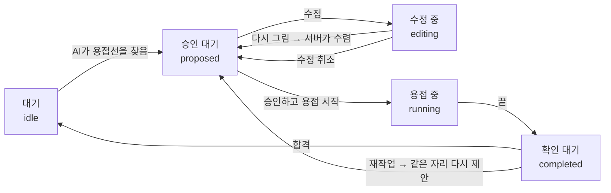
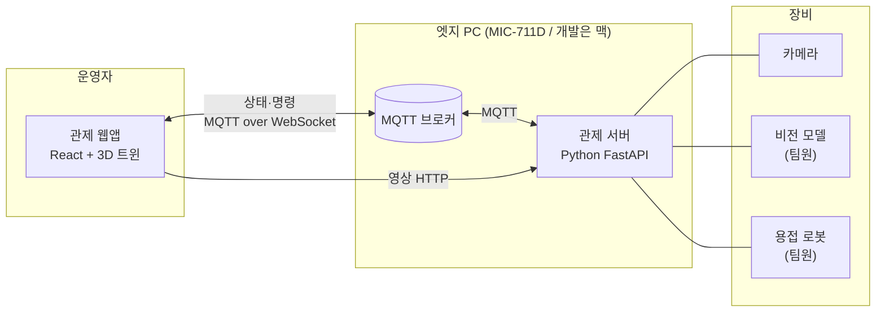

# 개요

> 처음 보는 사람이 "이게 무엇이고, 지금 어디까지 됐는가"를 10분 안에 알게 하는 문서다.
> 실행·조작은 [usage.md](usage.md), 내부 구조는 [architecture.md](architecture.md)를 본다.

## 한 줄 요약

**AI가 찾은 용접선을 사람이 3D 디지털 트윈 화면에서 확인·수정·승인하면, 로봇이 용접하고 사람이 결과를 확인하는 관제 소프트웨어**다. 조선소 블록 안처럼 사람이 들어가기 힘든 현장에서, 4족 자석발 이동 용접 로봇을 사람이 안전하게 지휘하도록 돕는다.

## 왜 만드는가

| 문제 | 이 소프트웨어의 답 |
| --- | --- |
| 선체 블록 안(이중저, 늑판 사이)은 좁고 위험해서 용접공이 오래 들어가 있기 어렵다 | 벽·바닥에 자석발로 붙는 이동 용접 로봇이 대신 들어간다 |
| AI 비전이 용접선을 찾아도 틀릴 수 있고, 잘못 용접하면 되돌릴 수 없다 | AI는 **제안만** 한다. 사람이 영상 위 붉은 선을 보고 **승인해야** 로봇이 움직인다(HITL, Human-in-the-loop) |
| AI가 조금 빗나갔을 때 처음부터 다시 하면 느리다 | 사람이 영상 위에 손가락으로 대충 그으면 서버가 실제 용접선에 **달라붙게(수렴)** 고쳐 준다 |
| 로봇이 어디서 무엇을 하는지 현장 밖에서는 안 보인다 | 현장을 본뜬 **3D 디지털 트윈**에서 로봇 자세·진행률·알람을 실시간으로 본다 |
| 문제가 생기면 바로 멈춰야 한다 | 어느 화면에서나 **긴급정지**, 운영자 화면이 끊기면 서버가 알아서 **일시정지** |

## 누가 쓰나

| 사람 | 하는 일 | 쓰는 화면 |
| --- | --- | --- |
| 현장 운영자 | 제안 확인, 수정, 승인, 결과 확인, 정지 | 관제 화면(노트북·태블릿) |
| 개발자 | 기능 추가, 검사, 장비 연결 | 관제 화면 + 트윈 랩·로봇 랩 + 검사 하네스 |
| 팀원(비전·로봇 담당) | 비전 모델과 로봇 제어 코드를 서버에 붙인다 | `server/adapters/` |

## 작업 한 번의 흐름

로봇 한 대가 용접선 하나를 처리하는 과정이다. 상태 이름(`proposed` 등)은 화면 배지와 서버 메시지에 그대로 나온다.

1. **제안**: 서버가 카메라 영상에서 용접선을 찾아(비전 모델) 붉은 선과 AI 신뢰도를 보낸다.
2. **확인·수정**: 운영자가 영상 위 선을 본다. 틀렸으면 **수정**을 누르고 다시 긋는다. 서버가 실제 용접선에 맞춰 돌려준다.
3. **승인**: **승인하고 용접 시작**을 누르면 로봇이 용접한다. 3D 트윈에서 로봇이 움직이고 진행률이 오른다.
4. **결과 확인**: 끝나면 **합격** 또는 **재작업**을 누른다. 결과는 서버에 기록된다.
5. **언제든 정지**: **이 로봇 정지**(한 대) 또는 **전체 긴급정지**(모든 로봇). **재개**로 다시 승인 대기로 돌아온다. 용접 중에 멈췄다면 남은 경로만 다시 제안된다.

## 시스템 한눈에

- **관제 웹앱**(`frontend/`): 3D 트윈, 로봇 패널, 알람, 정지 버튼. 명령만 보내고, 화면은 서버가 보낸 상태로만 바꾼다.
- **MQTT 브로커**: 웹과 서버 사이의 우편함. 상태·명령·알람이 모두 토픽으로 오간다.
- **관제 서버**(`server/`): 작업 상태의 유일한 기준. 명령을 검사하고, 비전·로봇·카메라를 묶는다.
- **장비 어댑터**(`server/adapters/`): 팀원 코드와 만나는 유일한 자리. 지금은 가짜(Mock) 구현으로 끝까지 돈다.
- **디지털 트윈 에셋**(`digital-twin/`): 현장 3D 모델(USD 원본 → 웹용 GLB), 사이트 설정, 시나리오 녹화본.
- **공통 규약**(`contracts/`): 토픽과 메시지 형식(JSON Schema). 웹·서버 모두 여기만 따른다.

## 지금 어디까지 됐나 (2026-11-20)

| 구획 | 상태 | 남은 것 |
| --- | --- | --- |
| 디지털 트윈 | M0~M5 완료. 사이트 2개(`ship-block` 조선소 이중저 블록·로봇 2대, `factory` 공장 용접 부스), 4족 로봇 모델, 실시간 MQTT 연결 | 이동 경로(계획) 표시, M3 사람 검수 |
| 관제 웹앱 | F0~F4 완료. 승인·수정·수렴·정지·알람·연결 상태·메트릭, 노트북·태블릿 가로·세로 | 실제 태블릿에서 터치 조작 사람 확인 |
| 관제 서버 | Mock 장비로 처음부터 끝까지 동작. 상태 머신, 계약 검증, 경로 수렴, 안전 정지, 저장 | 실제 비전·로봇·카메라 연결, Jetson 실행 확인 |
| 공통 규약 | 토픽 9종 + 명령 7종 스키마, 예시·검사 | 인증·TLS, 카메라 캘리브레이션 절차 |

### 무엇이 진짜고 무엇이 가짜(Mock)인가

| 부품 | 지금 | 진짜로 바꾸려면 |
| --- | --- | --- |
| 카메라 | 생성한 강판·용접선 그림 한 장(로봇마다) | `server/camera/device.py` + `server/calib/{site}.json` |
| 비전 모델 | 그림 속 정답 용접선을 신뢰도 0.88로 제안, 둘레에 확률 맵 | `server/adapters/vision_real.py` |
| 로봇 | 녹화본(픽스처)의 걸음·용접 자세를 진행률에 맞춰 재생 | `server/adapters/robot_real.py` |
| 브로커 | 맥에서는 Node 브로커(aedes) | 엣지에서는 mosquitto(`infra/mosquitto.conf`) |
| 상태 머신·수렴·안전·저장·웹 | **진짜**(실제 운영 코드) | — |

`./init.sh`로 띄우면 위 가짜 장비로 운영자 흐름 전체를 직접 눌러 볼 수 있다.

## 검수할 때 볼 것

주장마다 확인하는 방법을 붙였다. 명령은 저장소 루트에서 실행한다.

| 주장 | 확인 방법 |
| --- | --- |
| 명령 하나로 실행된다 | `./init.sh` → http://localhost:5173/ ([usage.md](usage.md) 1절) |
| 운영자 흐름(제안→승인→완료→확인, 수정, 정지)이 동작한다 | 화면에서 직접([usage.md](usage.md) 3절) 또는 관제 L3 검사 19개 |
| 웹은 서버 상태로만 화면을 바꾼다 | L3 "보낸 직후에는 화면이 바뀌지 않고 응답을 기다린다", `frontend/src/panel/controls.ts` |
| 서버 상태 머신이 모든 전이·거부를 지킨다 | `npm run test:server`(pytest 44개), [server/docs/state-machine.md](../server/docs/state-machine.md) |
| Node Mock과 파이썬 서버가 같은 규칙을 따른다 | 같은 관제 L3를 두 서버로 돌린다(`check.sh` L3 두 단계) |
| 메시지가 계약을 어기면 걸러진다 | L0 스키마 검사, 서버는 보낼 때 예외·받을 때 거부 알람 |
| 화면이 의도치 않게 바뀌지 않았다 | L4 기준 이미지 비교(사람이 승인한 이미지만 기준이 된다) |
| 전체 검사 | `digital-twin/harness/check.sh`(L0~L4, 5~6분) |

## 용어

| 용어 | 뜻 |
| --- | --- |
| HITL | Human-in-the-loop. AI가 제안하고 사람이 승인해야 실행되는 방식 |
| 디지털 트윈 | 현장을 본뜬 3D 장면. 실시간 데이터로 로봇 자세·상태가 움직인다 |
| 셀(cell) | 작업 단위 = **로봇 1대**. 토픽 `innoworks/{site}/{cell}/…`의 `{cell}`이 로봇 id(예: `spider-1`) |
| 사이트(site) | 현장 하나(예: `ship-block`, `factory`) |
| 면(surface) | 용접선이 놓인 강판 면(바닥 외판, 측면 외판 등). 경로 좌표는 그 면 위 mm |
| 제안(proposal) | AI가 찾은 용접 경로. 영상 픽셀 경로와 면 mm 경로를 함께 보낸다 |
| 수렴(snap) | 사람이 대충 그은 선을 실제 용접선에 맞춰 붙이는 것 |
| retained | 브로커가 마지막 값을 기억해 새로 붙은 화면에 바로 주는 MQTT 기능. 작업 상태에 쓴다 |
| LWT(유언) | 연결이 비정상으로 끊기면 브로커가 대신 보내는 메시지. 서버가 죽으면 `status=offline` |
| heartbeat | 운영자 화면이 1초마다 "살아 있다"고 보내는 신호. 3초 끊기면 서버가 용접을 일시정지 |
| 픽스처 | 토픽 메시지를 시간 순서로 녹화한 파일(JSONL). 서버 없이 화면을 재생·검사할 때 쓴다 |
| Mock | 실제 장비 대신 같은 모양으로 답하는 가짜 구현 |
| 하네스 | 검사 장치. `check.sh` 하나로 L0(정적)~L5(성능) 검사를 돌린다 |
| 기준 이미지(golden) | 사람이 승인한 화면 스크린샷. L4가 지금 화면과 비교한다 |
| ADR | 설계 결정 기록(`docs/adr/`). 왜 그렇게 정했는지 한 장씩 |
| MIC-711D | 현장에 둘 엣지 PC(NVIDIA Jetson 기반). 브로커와 서버가 여기서 돈다 |

## 다음에 읽을 것

1. [usage.md](usage.md): 설치·실행, 화면 조작, 검사, 문제 해결
2. [architecture.md](architecture.md): 구성, 메시지 흐름, 상태 머신, 모듈, 설계 결정
3. 구획별 상세: [contracts](../contracts/docs/README.md) · [digital-twin](../digital-twin/docs/README.md) · [server](../server/docs/README.md) · [frontend](../frontend/docs/README.md)
